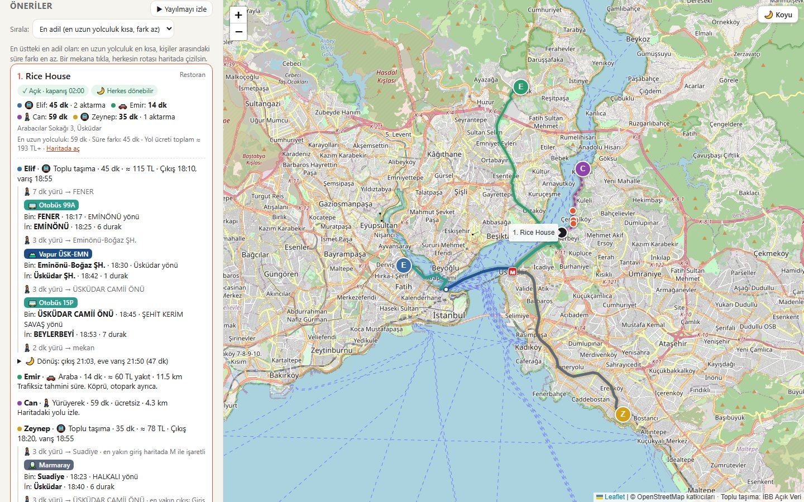
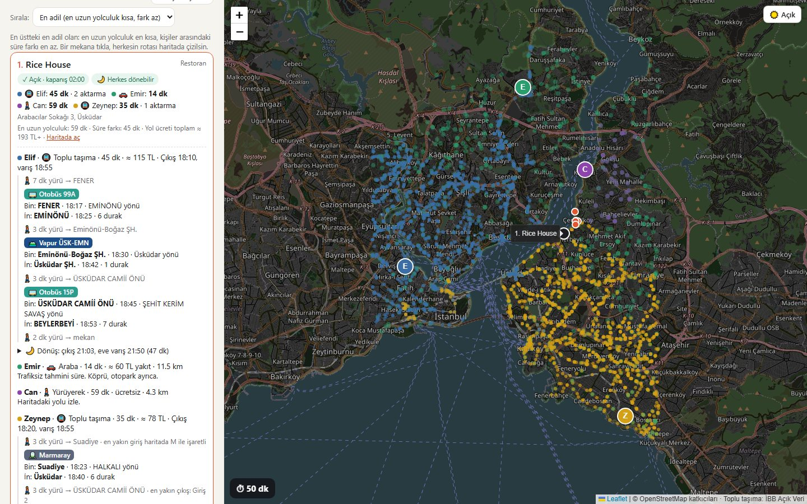
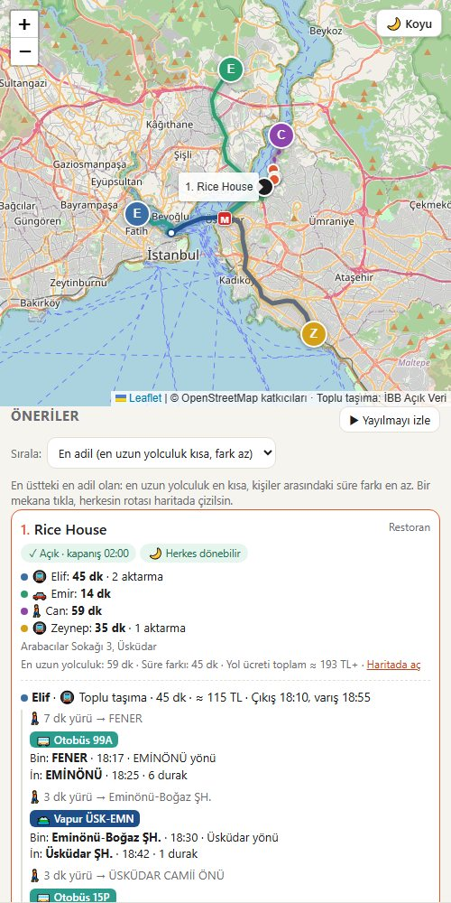
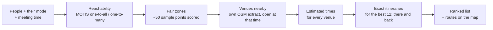

<div align="center">

# ◎ Orta Nokta

**Find the fairest place for a group of friends to meet in Istanbul — by real travel time, not straight-line distance.**

Everyone picks how they travel: metro, Marmaray, bus, ferry, car, on foot or by bike.
Orta Nokta finds cafés, bars, restaurants and venues where nobody is stuck with a two-hour trip, and tells each person exactly which line to take and where to get off.

[🇹🇷 Türkçe](README.tr.md) · [How it works](#how-it-works) · [Run it locally](#run-it-locally) · [Data & licenses](#data--licenses)




</div>

---

## Why

"Let's meet halfway" sounds simple until you live in Istanbul. Halfway on the map can mean a 15-minute ferry for one friend and a 90-minute bus ride for another. The Bosphorus, the bridges and the rail network decide who gets there fast, not the distance.

Orta Nokta ("middle point" in Turkish) treats the question the way people actually travel:

- It measures **door-to-door travel time** on the real network.
- Each person has **their own mode**: someone walking can't use a motorway, someone on transit has to wait for the ferry.
- It looks for the place where **the longest trip is as short as possible**, and where trips are as **equal** as possible.

## Features

| | |
|---|---|
| 🚇 **Mixed groups** | Each person chooses transit, car, walking or bike. All times are compared in minutes. |
| 🗺️ **Step-by-step transit directions** | "Walk 7 min to Fener → bus 99A towards Eminönü at 18:17, 6 stops → ferry to Üsküdar → …", with the nearest station entrance. |
| ⚖️ **Fairness ranking** | The default minimizes the longest trip plus half the gap between the fastest and slowest person. Or rank by total time or fewest transfers. Each transfer adds a small penalty, so a route isn't chosen just because it saves one minute with three changes. |
| 🕖 **Meeting time & duration** | Transit timetables depend on the hour. Venues that are closed at that time are dropped, and venues that close before you leave are flagged (using OpenStreetMap opening hours). |
| 🌙 **Getting home** | When the meetup ends, it checks that everyone can still get home by transit and warns if someone would be stranded. |
| 💸 **Fare estimate** | Approximate İstanbulkart fares (distance-based for Marmaray) and fuel cost for drivers. |
| 🌊 **Watch the flood** | An animation of every person's reachable area spreading out across the city at the same time, until the areas meet. |
| 📱 **Phone-friendly** | Responsive layout, plus a local HTTPS server so a phone on the same Wi-Fi can use its own GPS location. |
| 🔗 **Shareable link** | Everyone's position and mode are stored in the URL. Send it to the group and each person adds their own location. |

<table>
  <tr>
    <td width="66%"></td>
    <td width="34%"></td>
  </tr>
  <tr>
    <td align="center"><sub>“Watch the flood”: everyone sets off at once</sub></td>
    <td align="center"><sub>Phone layout</sub></td>
  </tr>
</table>

## How it works



1. **Reachability.** For each transit user, a single MOTIS `one-to-all` query returns every stop they can reach before the meeting, and how long it takes. Drivers, walkers and cyclists use MOTIS `one-to-many` street routing on the same Istanbul map.
2. **Fair zone.** About 50 points around the group are scored by *longest trip + ½ × (longest − shortest)*. The best zone, plus a second one if it lies far away (for example on the other shore), is kept.
3. **Venues.** Cafés, bars, restaurants, cinemas, theatres and more come from a local OpenStreetMap extract (`mekanlar.json`, ~10,600 places). Venues that are closed at the meeting time are removed.
4. **Exact plans.** For the top candidates, every transit user gets a real itinerary that arrives by the meeting time, plus a return trip home after it ends.
5. **Ranking & display.** Results are re-ranked with exact times, transfer penalties, early-closing venues and missing return trips. Clicking a venue draws each person's route leg by leg.

### Accuracy check

Five routes compared with Google Maps (weekday, ~17:30 departure):

| Route | Google Maps | Orta Nokta |
|---|---|---|
| Balat → Kadıköy | 52 min (bus → ferry → bus) | 48–54 min (same lines) |
| Suadiye → Taksim | 50 min (Marmaray → M2) | 44 min (same lines) |
| Kandilli → Beşiktaş | 31 min | 37 min |
| Maslak → Beylerbeyi | 55 min | 43–50 min |
| Bakırköy → Üsküdar | 26 min (Marmaray) | 32 min (Marmaray) |

Same lines and transfer points, with an average difference of about 6–7 minutes. The main known gaps are the walk from the platform to the street in deep stations, and minibuses (dolmuş) that have no fixed timetable. More detail is in [docs/PLAN.md](docs/PLAN.md).

## Run it locally

> ⚠️ This is a prototype. There is no public demo, because the routing engine needs a server, so it runs on your own computer. The interface is in Turkish.

**Requirements:** Windows (or Linux/macOS with the matching MOTIS build), Python 3.10+, about 1 GB of free disk space. The routing server uses roughly 250 MB of RAM while it runs.

```bash
git clone https://github.com/BaranIrmak08/ortanokta.git
cd ortanokta
pip install osmium
```

```bash
# 1. Download Istanbul transit data (İBB Open Data) and the Istanbul OpenStreetMap extract
python veri/indir.py
```

```bash
# 2. Clean the data (the official CSVs need repairs, see below) and extract venues
python veri/hazirla.py
python veri/mekanlar.py
```

3. Download [MOTIS v2.11.4](https://github.com/motis-project/motis/releases/tag/v2.11.4) into a `motis/` folder. Copy `veri/motis-config.yml` to `motis/config.yml`, then run `motis.exe import` inside it. This takes about 15 seconds.
4. Start everything with **`baslat.bat`**, or run `motis server` and `python sunucu.py` yourself, then open <http://localhost:5173>.

**On your phone:** `sunucu.py` prints an `https://<your-pc-ip>:5443` address. Open it on a phone connected to the same Wi-Fi. The certificate is self-signed, so you have to accept the browser warning once.

**Tests:** `node test/saatler.test.js` checks the opening-hours parser.

### Fixing the open data

The İBB transit CSVs have been through Excel, and `veri/hazirla.py` repairs them:

- **Broken bus stop coordinates:** `410.191.700.005.564` becomes `41.0191700005564`.
- **Truncated timetable:** the bus `stop_times.csv` is cut off at exactly 1,048,576 rows (Excel's limit), so the full ZIP version is used instead.
- **Mixed formats:** encodings (UTF-8 / Windows-1254) and separators are normalized.
- **Missing times:** empty times at intermediate stops are interpolated by distance.
- **Expired calendars:** the 2024 rail and ferry calendars are extended.
- **Frequency-based trips:** minibus and dolmuş trips are defined as "every N minutes", so they are expanded into individual trips. Left to MOTIS, the import took more than 40 minutes; pre-expanded, it takes 12 seconds.
- **Realistic transfers:** transfer times between nearby rail platforms are added, for example Marmaray ↔ M2 at Yenikapı.

## Project structure

```
index.html, style.css      the page
app.js                     search, ranking, directions, map, animation
saatler.js                 OpenStreetMap opening_hours parser
sunucu.py                  local web server + /motis proxy + HTTPS for phones
mekanlar.json              ~10,600 venues extracted from OpenStreetMap
girisler.json              524 metro / rail station entrances
veri/                      data download, cleaning, venue extraction, route comparison
docs/                      development notes and plans (Turkish)
test/                      tests
```

## Data & licenses

- **Code:** [MIT](LICENSE)
- **Map data, venues, station entrances:** © [OpenStreetMap contributors](https://www.openstreetmap.org/copyright), ODbL 1.0
- **Public transport timetables:** [Istanbul Metropolitan Municipality Open Data Portal](https://data.ibb.gov.tr) ("IETT GTFS Data" and "Public Transport GTFS Data"). They are downloaded by the script and are not stored in this repository.
- **Routing engine:** [MOTIS](https://github.com/motis-project/motis) (MIT)
- **Map library:** [Leaflet](https://leafletjs.com) · **Address suggestions:** [Photon](https://photon.komoot.io) by komoot

## Limitations & ideas

- Car times assume no traffic.
- Rail and ferry timetables come from the most recent İBB release (2024), so lines opened after that may be missing.
- Fares are estimates, and only about 12% of venues have opening hours in OpenStreetMap.
- **Not yet built:** a live shared group room where everyone joins from their own phone. This needs a hosted server.

---

<div align="center"><sub>Built by <a href="https://github.com/BaranIrmak08">Baran Irmak</a>. The idea came from those “where should N friends meet?” map videos, made real for Istanbul's transit.</sub></div>
