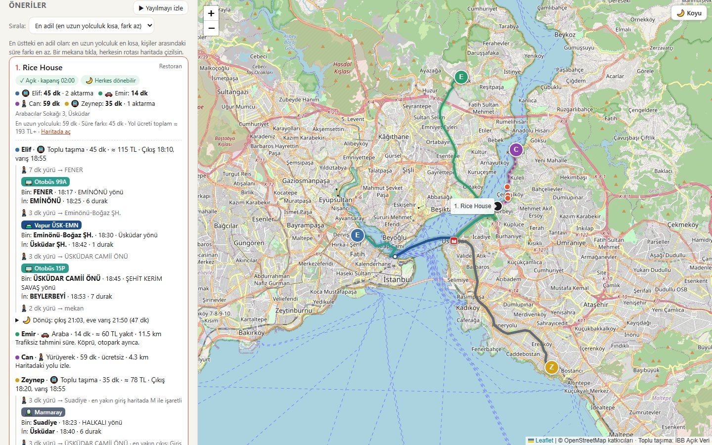
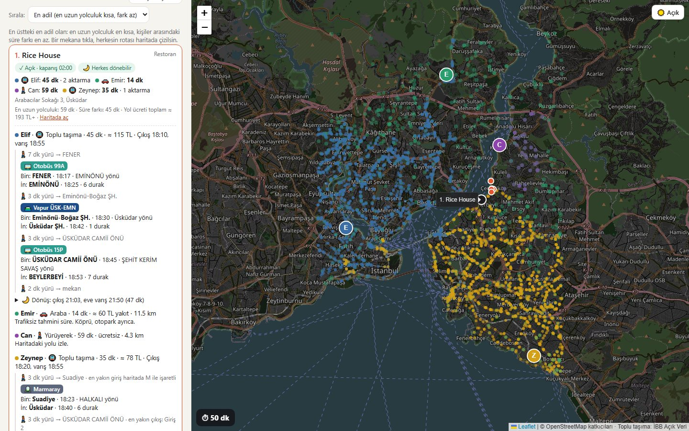
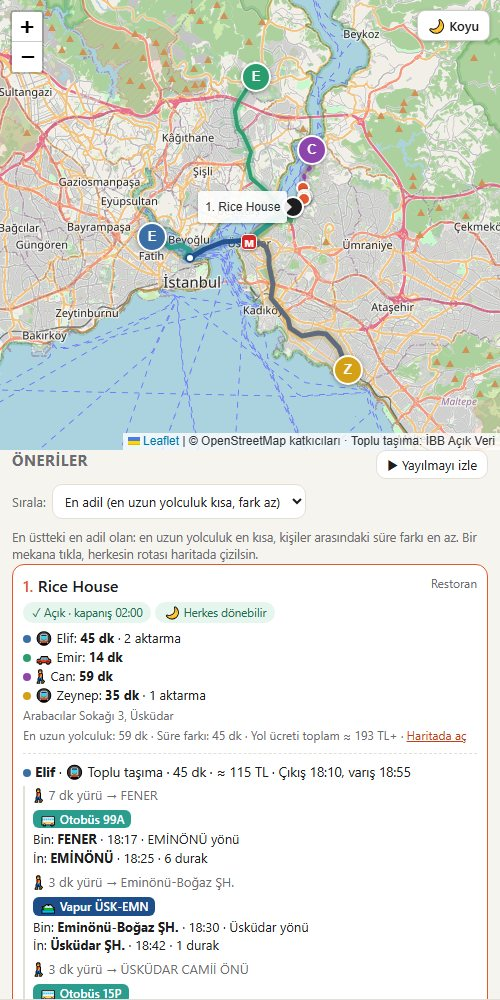
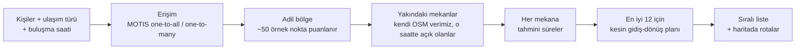

<div align="center">

# ◎ Orta Nokta

**Arkadaş grubunun İstanbul'da buluşacağı en adil yeri bulur. Kuş uçuşu mesafeye göre değil, gerçek yolculuk süresine göre.**

Herkes nasıl geleceğini seçer: metro, Marmaray, otobüs, vapur, araba, yürüyerek ya da bisikletle.
Orta Nokta, kimsenin iki saat yolda kalmadığı kafe, bar, restoran ve etkinlik mekanlarını bulur. Herkese hangi hatta binip nerede ineceğini de tek tek söyler.

[🇬🇧 English](README.md) · [Nasıl çalışır](#nasıl-çalışır) · [Bilgisayarında çalıştır](#bilgisayarında-çalıştır) · [Veri ve lisanslar](#veri-ve-lisanslar)




</div>

---

## Neden

"Ortada buluşalım" demek kolay, ama İstanbul'da yaşıyorsan iş öyle değil. Haritadaki orta nokta, bir arkadaş için 15 dakikalık vapur, öbürü için 90 dakikalık otobüs yolculuğu olabilir. Kimin hızlı varacağını mesafe değil; boğaz, köprüler ve raylı sistem belirler.

Orta Nokta soruyu insanların gerçekten yolculuk ettiği gibi ele alır:

- **Kapıdan kapıya süreyi** gerçek ulaşım ağı üzerinden ölçer.
- Herkesin **kendi ulaşım türü** vardır: yürüyen kişi otoyola giremez, toplu taşımayla gelen vapuru bekler.
- **En uzun yolculuğun olabildiğince kısa**, sürelerin de olabildiğince **eşit** olduğu yeri arar.

## Özellikler

| | |
|---|---|
| 🚇 **Karışık grup** | Herkes toplu taşıma, araba, yürüyüş ya da bisiklet seçer. Bütün süreler dakika olarak karşılaştırılır. |
| 🗺️ **Adım adım toplu taşıma tarifi** | "7 dk yürü → Fener · 18:17'de 99A otobüsüne bin (Eminönü yönü), 6 durak → Üsküdar vapuru → …" gibi. En yakın istasyon girişi de gösterilir. |
| ⚖️ **Adil sıralama** | Varsayılan sıralama en uzun yolculuğu ve en hızlı ile en yavaş kişi arasındaki farkı en aza indirir. İstersen toplam süreye ya da en az aktarmaya göre de sıralanır. Her aktarma küçük bir ceza ekler; böylece 1 dakika kazandırıyor diye 3 aktarmalı rota seçilmez. |
| 🕖 **Buluşma saati ve kalış süresi** | Toplu taşıma sefer saatlere bağlıdır. O saatte kapalı olan mekanlar elenir, siz kalkmadan kapanacak olanlar işaretlenir (OpenStreetMap açılış saatleri). |
| 🌙 **Eve dönüş** | Buluşma bitince herkesin toplu taşımayla eve dönebildiğine bakar. Biri dönemeyecekse uyarır. |
| 💸 **Ücret tahmini** | Yaklaşık İstanbulkart ücreti (Marmaray'da mesafeye göre) ve arabayla gelenin yakıt masrafı. |
| 🌊 **Yayılmayı izle** | Herkesin ulaşabildiği alanın aynı anda şehre yayılıp buluştuğu animasyon. |
| 📱 **Telefona uygun** | Telefon ekranına uyan düzen. Yerel HTTPS sunucusu sayesinde aynı Wi-Fi'deki telefon kendi konumunu kullanabilir. |
| 🔗 **Paylaşılabilir bağlantı** | Herkesin konumu ve ulaşım türü bağlantının içinde saklanır. Gruba atarsın, herkes kendi konumunu ekler. |

<table>
  <tr>
    <td width="66%"></td>
    <td width="34%"></td>
  </tr>
  <tr>
    <td align="center"><sub>"Yayılmayı izle": herkes aynı anda yola çıkıyor</sub></td>
    <td align="center"><sub>Telefon düzeni</sub></td>
  </tr>
</table>

## Nasıl çalışır



1. **Erişim.** Toplu taşımayla gelen her kişi için tek bir MOTIS `one-to-all` sorgusu, buluşmadan önce ulaşabileceği bütün durakları ve kaç dakikada varacağını döndürür. Araba, yürüyüş ve bisiklet için aynı İstanbul haritası üzerinde MOTIS `one-to-many` kullanılır.
2. **Adil bölge.** Grubun çevresindeki yaklaşık 50 nokta *en uzun yolculuk + ½ × (en uzun − en kısa)* ile puanlanır. En iyi bölge tutulur; ikinci iyi bölge uzaktaysa (ör. öbür yakada) o da aday olur.
3. **Mekanlar.** Kafe, bar, restoran, sinema, tiyatro gibi mekanlar yerel bir OpenStreetMap çıkarımından gelir (`mekanlar.json`, yaklaşık 10.600 mekan). Buluşma saatinde kapalı olanlar elenir.
4. **Kesin plan.** En iyi adaylar için toplu taşımacıların her birine buluşma saatinde orada olacak gerçek bir yolculuk planı çıkarılır. Buluşma bitince eve dönüş de hesaplanır.
5. **Sıralama ve gösterim.** Sonuçlar kesin sürelere, aktarma cezalarına, erken kapanan mekanlara ve dönüşü olmayan kişilere göre yeniden sıralanır. Bir mekana tıklayınca herkesin rotası parça parça çizilir.

### Doğruluk kontrolü

Beş rota Google Haritalar ile karşılaştırıldı (hafta içi, ~17:30 çıkış):

| Rota | Google Haritalar | Orta Nokta |
|---|---|---|
| Balat → Kadıköy | 52 dk (otobüs → vapur → otobüs) | 48–54 dk (aynı hatlar) |
| Suadiye → Taksim | 50 dk (Marmaray → M2) | 44 dk (aynı hatlar) |
| Kandilli → Beşiktaş | 31 dk | 37 dk |
| Maslak → Beylerbeyi | 55 dk | 43–50 dk |
| Bakırköy → Üsküdar | 26 dk (Marmaray) | 32 dk (Marmaray) |

Motor aynı hatları ve aynı aktarma noktalarını seçiyor, ortalama fark yaklaşık 6–7 dakika. Bilinen başlıca farklar: derin istasyonlarda perondan sokağa çıkış süresi ve sabit sefer saati olmayan minibüs/dolmuşlar. Ayrıntılar [docs/PLAN.md](docs/PLAN.md) dosyasında.

## Bilgisayarında çalıştır

> ⚠️ Bu bir prototip. Rota motoru bir sunucu gerektirdiği için herkese açık bir deneme sürümü yok; kendi bilgisayarında çalışıyor.

**Gerekenler:** Windows (ya da uygun MOTIS sürümüyle Linux/macOS), Python 3.10+, yaklaşık 1 GB boş disk. Rota sunucusu çalışırken yaklaşık 250 MB bellek kullanır.

```bash
git clone https://github.com/BaranIrmak08/ortanokta.git
cd ortanokta
pip install osmium
```

```bash
# 1. İstanbul toplu taşıma verisini (İBB Açık Veri) ve İstanbul OpenStreetMap haritasını indir
python veri/indir.py
```

```bash
# 2. Veriyi düzelt (resmi CSV'lerin onarılması gerekiyor, aşağıya bak) ve mekanları çıkar
python veri/hazirla.py
python veri/mekanlar.py
```

3. [MOTIS v2.11.4](https://github.com/motis-project/motis/releases/tag/v2.11.4) sürümünü `motis/` klasörüne indir. `veri/motis-config.yml` dosyasını `motis/config.yml` olarak kopyala ve o klasörde `motis.exe import` çalıştır. Yaklaşık 15 saniye sürer.
4. Her şeyi **`baslat.bat`** ile başlat (ya da `motis server` ve `python sunucu.py` komutlarını kendin çalıştır), sonra <http://localhost:5173> adresini aç.

**Telefonda:** `sunucu.py` açılınca bir `https://<bilgisayar-ip>:5443` adresi yazar. Aynı Wi-Fi'deki telefonda bu adresi aç. Sertifika kendinden imzalı olduğu için tarayıcı uyarısını bir kez onaylaman gerekir.

**Testler:** `node test/saatler.test.js` açılış saati çözücüsünü sınar.

### Açık verinin onarılması

İBB toplu taşıma CSV'leri Excel'den geçmiş; `veri/hazirla.py` şunları düzeltir:

- **Bozuk durak koordinatları:** `410.191.700.005.564` → `41.0191700005564`.
- **Kesik tarife:** Otobüs `stop_times.csv` dosyası tam 1.048.576 satırda (Excel sınırı) kesilmiş; bu yüzden tam hali olan ZIP sürümü kullanılır.
- **Karışık biçim:** Kodlama (UTF-8 / Windows-1254) ve ayraç farkları giderilir.
- **Eksik saatler:** Ara duraklardaki boş saatler mesafeye göre doldurulur.
- **Süresi geçmiş takvimler:** Raylı sistem ve vapurun 2024'te biten takvimleri uzatılır.
- **Sıklıkla tanımlı seferler:** "Her N dakikada bir" diye tanımlı minibüs ve dolmuş seferleri tek tek açılır. MOTIS'e bırakılınca içe aktarma 40 dakikayı geçiyordu; önceden açınca 12 saniye sürüyor.
- **Gerçekçi aktarmalar:** Yakın raylı peronlar arasına aktarma süreleri eklenir (ör. Yenikapı'da Marmaray ↔ M2).

## Proje yapısı

```
index.html, style.css      sayfa
app.js                     arama, sıralama, tarif, harita, animasyon
saatler.js                 OpenStreetMap açılış saati çözücüsü
sunucu.py                  yerel site sunucusu + /motis aktarımı + telefon için HTTPS
mekanlar.json              OpenStreetMap'ten ~10.600 mekan
girisler.json              524 metro/raylı istasyon girişi
veri/                      veri indirme, onarma, mekan çıkarma, rota karşılaştırma
docs/                      geliştirme notları ve planlar
test/                      testler
```

## Veri ve lisanslar

- **Kod:** [MIT](LICENSE)
- **Harita, mekanlar, istasyon girişleri:** © [OpenStreetMap katkıcıları](https://www.openstreetmap.org/copyright), ODbL 1.0
- **Toplu taşıma tarifeleri:** [İBB Açık Veri Portalı](https://data.ibb.gov.tr) ("IETT GTFS Data" ve "Public Transport GTFS Data"). Betik tarafından indirilir, bu repoda saklanmaz.
- **Rota motoru:** [MOTIS](https://github.com/motis-project/motis) (MIT)
- **Harita kütüphanesi:** [Leaflet](https://leafletjs.com) · **Adres önerisi:** komoot'un [Photon](https://photon.komoot.io) servisi

## Sınırlar ve fikirler

- Araba süreleri trafiksiz hesaplanır.
- Raylı sistem ve vapur tarifeleri İBB'nin en son yayınladığı 2024 verisinden gelir; sonradan açılan hatlar eksik olabilir.
- Ücretler tahminidir. OpenStreetMap'te mekanların yalnızca yaklaşık %12'sinin açılış saati kayıtlı.
- **Henüz yapılmadı:** herkesin kendi telefonundan katıldığı canlı ortak grup odası. Bunun için bir sunucu gerekiyor.

---

<div align="center"><sub><a href="https://github.com/BaranIrmak08">Baran Irmak</a> tarafından yapıldı. Fikir, "N arkadaş nerede buluşmalı?" harita videolarından çıktı ve İstanbul'un toplu taşımasıyla gerçeğe dönüştü.</sub></div>
